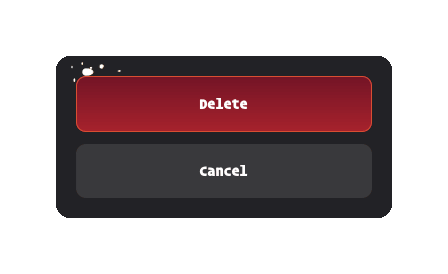

# destructive-confirm

**A small native confirmation dialog, with an optionally flaming confirm button.**

Use it from shell scripts before deletion, replacement, restart, or another
destructive action. It asks the question and returns an exit status; it **never
executes the action**, requests privileges, or changes your desktop theme.

- Native GTK 4/libadwaita buttons, keyboard navigation, and destructive styling.
- Four named animation presets, or no animation, selected at compile time.
- Only the selected artwork is embedded; installation needs no asset directory.
- Respects disabled animations and high contrast; reduced motion on GTK 4.22+.



*The `real-fire` preset, captured from the native dialog. `tall-ring` remains
the build default; [choose your preset](#choose-an-animation).*

## Quick start

After building, try this harmless example:

```sh
if ./build/destructive-confirm \
    --title "Confirm action" \
    --text "Delete the selected item?" \
    --confirm-label "Delete" \
    --cancel-label "Keep it"
then
    printf '%s\n' 'Confirmed; this example does not delete anything.'
else
    printf '%s\n' 'Cancelled or unavailable; nothing changed.'
fi
```

Put your action **inside the successful branch**, never after an unconditional
semicolon. Treat every non-zero status as “do not proceed.” Enter activates
Confirm; Escape or closing the window cancels. This helper is a UI confirmation,
not an authorization or security boundary.

## Build

Build requirements:

- A C17 compiler, GNU Make, and `pkg-config` (or compatible `pkgconf`).
- GTK **4.14+** and libadwaita **1.5+**, including development headers.
- GLib's `glib-compile-resources`.

For example, on Ubuntu 24.04:

```sh
sudo apt install build-essential pkg-config libgtk-4-dev libadwaita-1-dev libglib2.0-dev-bin
```

From the source directory:

```sh
make
./build/destructive-confirm --help
```

Running a dialog requires a graphical session and a display backend supported
by your GTK build (Wayland or X11). `--help` and argument validation work without
a display. Blender and Python are **not** needed to build or run the application.

By default the destructive button catches fire: a visible spark ignites, flame
travels clockwise around the button, then settles into a tall burning ring.
Fire can overlap nearby space without changing native button sizes or hit
targets. High-contrast mode uses a plain red button instead.

## Install

```sh
make install
```

This installs `destructive-confirm` and its compatibility symlink `power-confirm`
in `~/.local/bin`, plus the README and license notices in
`~/.local/share/doc/destructive-confirm`. Ensure `~/.local/bin` is in your `PATH`.

Packagers can override the prefix and stage an installation without root:

```sh
: "${pkgdir:?Set pkgdir to an absolute staging directory}"
make PREFIX=/usr DESTDIR="$pkgdir" install
```

`BINDIR` and `DOCDIR` can also be overridden. To remove the installed files,
run `make uninstall` with the **same path overrides** used for installation.
It leaves your source checkout, local configuration, and unrelated files alone.

## Usage

```sh
destructive-confirm [--title TITLE] [--text TEXT] \
    [--confirm-label LABEL] [--cancel-label LABEL]
```

| Option | Meaning | Default |
| --- | --- | --- |
| `--title TITLE` | Window title | `Confirm` |
| `--text TEXT` | Message above the buttons | Omitted: compact, button-only dialog |
| `--confirm-label LABEL` | Destructive response label | `OK` |
| `--cancel-label LABEL` | Cancel response label | `Cancel` |
| `-h`, `--help` | Print help without opening a dialog | |

Quote all text arguments. For a compact prompt, omit `--text`:

```sh
destructive-confirm --title "Replace item" \
    --confirm-label "Replace" --cancel-label "Keep existing"
```

### Exit status

| Status | Meaning |
| --- | --- |
| `0` | Confirmed, or help was requested |
| `1` | Cancelled, closed, Escape, or application failure |
| `2` | Invalid command-line arguments |
| Other non-zero | Startup failure, signal, or external timeout; do not proceed |

Normal prompts produce no result text on stdout. Diagnostics go to stderr.
Do not let untrusted input add options such as `--help` to a confirmation call:
help intentionally returns success without asking a question.

## Choose an animation

The first build copies `config.def.h` to the ignored local `config.h`. Edit
that header to choose one preset, then rebuild and reinstall:

```c
#define CONFIRM_ANIMATION ANIMATION_REAL_FIRE
```

| Header value | Preset | Appearance |
| --- | --- | --- |
| `ANIMATION_TALL_RING` | `tall-ring` **(default)** | Tall, curling Blender flames and a visible ignition spark |
| `ANIMATION_REAL_FIRE` | `real-fire` | Fluid-simulated rising flames and a visible ignition spark |
| `ANIMATION_FIRE_RING` | `fire-ring` | Smaller Blender ring with stepped ignition |
| `ANIMATION_SVG_FLAMES` | `svg-flames` | Animated SVG flames inside the button |
| `ANIMATION_NONE` | `none` | Plain red destructive button |

```sh
make
make install
```

Only the selected preset's stylesheet and artwork are embedded. `none` embeds
no flame images and links no fire-overlay player. The CLI and exit statuses are
identical for every preset; there is no runtime selector.

Local `config.h` is never overwritten, including by `make clean`. Compare it
with `config.def.h` after updating the source. Packagers/tests can use an
alternate header with `make CONFIG_H=/path/to/config.h`, and an external build
directory with `make BUILD_DIR=/path/to/build`. Selection changes rebuild the
resource bundle automatically; neither cleaning nor rendering is required.

See the [preset catalogue](data/presets/README.md) and
[Blender recipes](art/README.md) for the saved artwork and editable sources.

## Troubleshooting

- **Missing dependency:** install the development headers, not just runtime
  libraries. Check `pkg-config --modversion gtk4 libadwaita-1`.
- **Cannot open display:** run from your graphical session, not an unrelated
  SSH session or root shell. Keep the session's display and D-Bus environment.
  Do not disable display access controls to work around this.
- **No animated fire:** check `config.h`, rebuild **and reinstall**, and check
  GTK's animation/high-contrast preferences. No animation is intentional when
  `ANIMATION_NONE` is selected. Disabling motion shows overlay presets already
  ignited and still; high contrast removes their fire entirely.
- **An older binary runs:** check `command -v destructive-confirm`. A user-local
  installation may take precedence over a system package, or vice versa.

## Development

```sh
make check
make smoke-gui
make check-presets
python3 -B -m unittest discover -s art
```

`smoke-gui` opens temporary dialogs and uses `timeout` to prove they remain
alive awaiting a response. Preset tests need Python 3, `gresource`, and `nm`;
artwork tests also need Pillow. They do not rerender the Blender scenes.

See [CONTRIBUTING.md](CONTRIBUTING.md) for headless testing and contribution
guidelines, [the design notes](docs/design.md) for implementation tradeoffs,
and [the publication checklist](docs/publishing.md) for maintainer preparation.

## License

Copyright © 2026 Kristopher Keller and contributors.

Code, documentation, scene recipes, SVGs, and rendered animation frames are
licensed under **GPL-3.0-or-later**. See [LICENSE](LICENSE) and
[COPYRIGHT](COPYRIGHT). The editable artwork sources are included; no stock
footage, downloaded textures, or external Blender add-ons are bundled.
